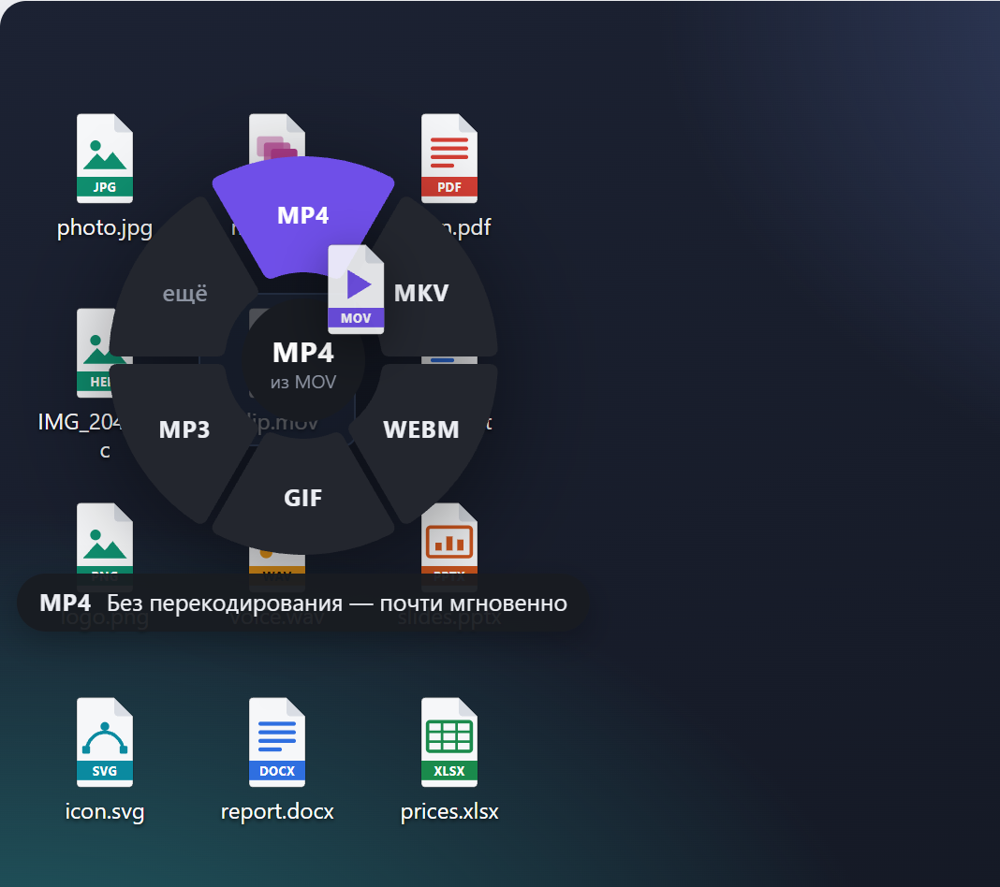

# Orbit

Меняет формат файла одним движением. Зажимаешь файл в Проводнике или на рабочем столе, вокруг появляется кольцо с форматами, ведёшь в нужный и отпускаешь. Всё, файл уже PNG, MP4 или PDF.



Кольцо открывается ещё двумя способами: потрясти файл, пока тащишь его, или выделить файлы и нажать Alt+Q.

Старый файл уходит в Корзину, а в уведомлении есть «Отменить». Если держать Ctrl, оригинал останется. Быстрое доделывается прямо в кольце, долгое вроде видео и презентаций идёт в фоне.

| Что | Во что |
| --- | --- |
| картинки: JPG, PNG, WEBP, HEIC, AVIF и другие | PNG, JPG, WEBP, PDF, ICO, SVG |
| видео | MP4, MKV, WEBM, GIF, MP3 |
| звук | MP3, WAV, FLAC, OGG, M4A |
| Word, PDF, Markdown | PDF, DOCX, TXT, MD |
| PowerPoint | PDF, MP4, картинки |
| Excel, CSV | XLSX, CSV, PDF |

Для перевода картинок в SVG написал свой обвод в вектор.

## Сборка

Нужны .NET 10 и FFmpeg (`winget install Gyan.FFmpeg`), для документов ещё Microsoft Office.

```
dotnet publish src\Orbit\Orbit.csproj -c Release -o dist
```

Дальше `dist\Orbit.exe`, живёт в трее. Прогнать все конвертеры без окон: `dotnet run --project tests\Orbit.Checks`.

C#, WPF, Magick.NET, FFmpeg.
